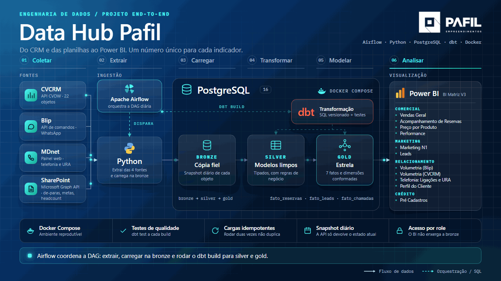

# Data Hub Pafil

Plataforma de dados da Pafil. Ela puxa os dados do CRM (CVCRM), do atendimento por
WhatsApp (Blip) e da telefonia (MDnet), organiza tudo em um banco PostgreSQL e entrega um
modelo pronto para o Power BI. O objetivo é ter um número único e confiável para cada
indicador, no lugar das planilhas e dos relatórios que divergiam entre si.

<p align="center">
  
</p>

*Arquitetura alvo do projeto. Hoje a produção roda sem Airflow e sem dbt, e os de-paras ainda vêm das planilhas por carga manual. Veja "O que roda em produção" e "Planejado" mais abaixo.*

| Camada | O que guarda | Onde está o código |
|---|---|---|
| **bronze** | Cópia fiel de cada fonte, mais um snapshot diário (a API só devolve o estado atual) | [`sql/bronze/`](sql/bronze/) |
| **silver** | Dados limpos e tipados, regras de negócio aplicadas e os de-paras (mapeamentos mantidos à mão) | [`sql/silver/`](sql/silver/) |
| **gold** | Fatos e dimensões para o Power BI (`fato_reservas`, `fato_leads`, `dim_corretor`...) | [`sql/gold/`](sql/gold/) |

Silver e gold são views (a exceção são as tabelas de de-para da silver), então refletem a
bronze na hora, sem passo de atualização.

## O que roda em produção

Tudo roda numa máquina Windows da empresa (acesso por RDP), onde o PostgreSQL 16 é um
serviço do Windows. As tarefas abaixo ficam no Agendador de Tarefas, rodando como `SYSTEM`,
e o código vem deste repositório (branch `master`, clonado em `C:\pafil\app`).

| Tarefa agendada | Quando | O que executa |
|---|---|---|
| `PafilDW - Backup diario` | 05:00 | [`infra/backup_pg.ps1`](infra/backup_pg.ps1) |
| `PafilDW - Ingestao diaria` | de hora em hora, 06:00 às 18:00 | `ingestao.py --incremental` (CVCRM para a bronze) |
| `PafilDW - Blip diario` | de hora em hora, a partir das 06:05 | `ingerir_blip.py --full` |
| `PafilDW - MDnet diario` | de hora em hora, a partir das 06:15 | [`infra/ingerir_mdnet.ps1`](infra/ingerir_mdnet.ps1) |

Como instalar, conferir e consertar cada uma delas: [`infra/README.md`](infra/README.md).

Os de-paras (`popular_seeds.py`) ainda são atualizados à mão, do notebook do analista, por
um túnel SSH até o banco de produção. Os arquivos de origem são planilhas do SharePoint que
só existem sincronizadas na máquina de quem as edita.

## Mapa do repositório

```
.
├── ingestao.py                # CVCRM (CVDW) para a bronze          (agendado)
├── ingerir_blip.py            # Blip para a bronze                  (agendado)
├── ingerir_mdnet*.py          # MDnet para a bronze: chamadas, pernas e URA (agendado)
├── aplicar_silver.py          # aplica as views da silver
├── aplicar_gold.py            # aplica as views da gold
├── aplicar_tudo.py            # silver, gold e seeds, em sequência
├── popular_seeds.py           # carrega os de-paras a partir das planilhas
├── criar_database.py          # cria o banco, se ainda não existir
├── conferir_carga.py          # compara o total da API com o total da bronze
│
├── config/                    # objetos.yml (o que ingerir), deparas.yml, settings.py
├── cvdw/  blip/  mdnet/       # clientes das APIs e utilitários de banco
├── sql/                       # DDL e views de cada camada
├── infra/                     # produção: PostgreSQL, backup, tarefas agendadas
├── powerbi/                   # medidas DAX e roteiros de cada página do relatório
├── ferramentas/               # scripts de uso manual (conferências, reconciliação)
├── reconciliacao/             # relatórios que comparam a plataforma com o BI antigo
└── docs/                      # documentação do projeto
```

Os scripts agendados ficam na raiz de propósito: as tarefas da máquina de produção apontam
para esses caminhos. Mudar um deles exige atualizar a tarefa correspondente.

## Para começar

Precisa de Python 3.10 ou mais novo e de um PostgreSQL 16 para testar (ou acesso ao banco de
produção por túnel). O passo a passo completo está em [`docs/onboarding.md`](docs/onboarding.md).
O resumo:

```bash
python -m venv .venv
.venv\Scripts\activate              # Linux/macOS: source .venv/bin/activate
pip install -r requirements.txt
copy .env.example .env              # preencha o .env (cada variável está comentada)

python criar_database.py            # cria o banco, se preciso
python ingestao.py --full --criar-tabelas   # carga completa (leva horas, a API é limitada)
python aplicar_tudo.py              # silver, gold e seeds
python conferir_carga.py            # confere a bronze contra a API
```

No dia a dia, só o incremental importa: `python ingestao.py --incremental`.

## Documentação

| Para quê | Documento |
|---|---|
| Montar o ambiente e rodar a primeira consulta | [`docs/onboarding.md`](docs/onboarding.md) |
| Entender o projeto e o estado atual | [`docs/contexto.md`](docs/contexto.md) |
| Ver como as peças se encaixam e onde ficam os segredos | [`docs/arquitetura.md`](docs/arquitetura.md) |
| Decisões já fechadas, segurança e LGPD | [`docs/decisoes.md`](docs/decisoes.md) |
| Consultar o banco (psql, DBeaver, pgAdmin) | [`docs/consultar-o-banco.md`](docs/consultar-o-banco.md) |
| Atualizar os de-paras | [`docs/de-paras.md`](docs/de-paras.md) |
| Comissão e Repasse: API, pipeline, números e armadilhas | [`docs/comissoes-e-repasses.md`](docs/comissoes-e-repasses.md) |
| Inventário de todos os endpoints do CVDW, com contagem ao vivo | [`docs/cvcrm-api-inventario.md`](docs/cvcrm-api-inventario.md) |
| Regras de negócio herdadas dos relatórios antigos | [`docs/regras-de-negocio.md`](docs/regras-de-negocio.md) |
| Desenho do modelo para o Power BI | [`docs/modelo-semantico.md`](docs/modelo-semantico.md) |
| Operar a máquina de produção | [`infra/README.md`](infra/README.md) |
| Montar o relatório no Power BI | [`powerbi/README.md`](powerbi/README.md) |
| Camadas silver e gold em detalhe | [`sql/silver/README.md`](sql/silver/README.md), [`sql/gold/README.md`](sql/gold/README.md) |
| Scripts manuais | [`ferramentas/README.md`](ferramentas/README.md) |

## Projetos vizinhos

Dois projetos que usam o mesmo banco ganharam repositório próprio:

- [`integracao-cvcrm-ghl`](https://github.com/arturvillasboas/integracao-cvcrm-ghl):
  sincronização nos dois sentidos entre o CVCRM e o GoHighLevel (n8n e schema `integracao`).
  Lê `bronze.leads`, então depende da ingestão deste repositório.
- [`automacao-reporting`](https://github.com/arturvillasboas/automacao-reporting): envio
  automático de prints de dashboards do Power BI por WhatsApp e e-mail (schema `reporting`).

## Como trabalhar neste repositório

- `master` é a produção: é o que a máquina da empresa baixa. Só entra nela o que já foi testado.
- Mudanças novas saem de uma branch curta (por exemplo `feature/nome-da-mudanca`), voltam para
  a `master` por pull request ou merge e a branch é apagada em seguida.
- Mudança de SQL vem com o arquivo `.sql` atualizado e, se mexer em regra de negócio, com a
  entrada correspondente em [`docs/regras-de-negocio.md`](docs/regras-de-negocio.md).
- Segredos ficam só no `.env` e nunca no Git. O `.env.example` mostra o formato.
- Dados pessoais de cliente só existem no banco da empresa. Nada de CSV com telefone, e-mail
  ou CPF no repositório.

## Planejado

A migração das transformações para dbt-core e do agendamento para Airflow foi decidida e está
planejada, mas ainda não foi implementada: o que roda hoje são os scripts Python e o
Agendador de Tarefas descritos acima. O acompanhamento fica nas issues e no Project do
GitHub deste repositório.
