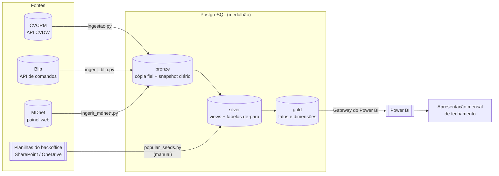

# Arquitetura

Visão de ponta a ponta: de onde o dado vem, como é transformado, onde mora e como o
Power BI o consome. Para o porquê de negócio, veja [`contexto.md`](contexto.md). Para o desenho
do modelo em estrela, [`modelo-semantico.md`](modelo-semantico.md). Para as decisões já
fechadas, [`decisoes.md`](decisoes.md).

## 1. De ponta a ponta

Os dados do CRM, do Blip e da MDnet caem na bronze sem tratamento. As planilhas mantidas à
mão pelo backoffice entram direto na silver, que também limpa e padroniza a bronze. A gold
organiza tudo em fatos e dimensões, e o Power BI lê a gold.

Como a API do CVDW só devolve o estado atual, cada objeto tem duas tabelas na bronze: a atual
(`bronze.<objeto>`, mantida por upsert) e o histórico (`bronze.<objeto>_snapshot`, que só
cresce, com uma cópia por dia). Rodar a carga duas vezes no mesmo dia não duplica nada.

## 2. Onde cada coisa roda

| Componente | Desenvolvimento (notebook do analista) | Produção (máquina Windows da empresa) |
|---|---|---|
| PostgreSQL | Um Postgres 16 local, ou o de produção por túnel SSH na porta 5433 | Postgres 16 como serviço do Windows (inicialização automática), porta 5432, `pg_hba.conf` restrito a `127.0.0.1` e `::1`. Sobrevive a logoff e a desconexão do RDP |
| Cargas (`ingestao.py`, `ingerir_blip.py`, `ingerir_mdnet*.py`) | Rodadas à mão | Tarefas agendadas do Windows, como `SYSTEM`, de hora em hora no horário comercial. A conexão é por `localhost` |
| Seeds de-para (`popular_seeds.py`) | Rodado à mão, lendo as planilhas sincronizadas pelo OneDrive | Não roda lá. Continua manual, do notebook, com o túnel SSH apontando para o banco de produção |
| Power BI | Desktop, conectando no banco local ou no túnel | Gateway instalado na própria máquina do banco, conectando em `localhost`. Habilita a atualização agendada no Power BI Service |
| Backup | Não se aplica | `pg_dump` diário às 05:00, copiado para fora da máquina |

Os horários exatos das tarefas e como instalá-las estão em [`infra/README.md`](../infra/README.md).

## 3. Proteção da máquina de produção

A máquina é uma estação Windows 10 Pro da empresa, acessada por RDP, sem a camada de
proteção de uma nuvem por trás (ainda falta confirmar com a TI se ela é de uso exclusivo do
projeto). Isso define o que a protege:

1. **Firewall do Windows** é a principal defesa de rede. A porta 5432 nunca é liberada para
   fora da máquina. O acesso do analista é por túnel SSH (OpenSSH Server do Windows), com a
   porta 22 liberada só para o IP do notebook.
2. **Uma sessão remota por vez.** O Windows 10 Pro (ao contrário do Server) permite uma sessão
   RDP simultânea. Se outra pessoa entrar, a sessão do analista é desconectada, mas o Postgres
   e as tarefas agendadas seguem rodando, porque são serviços do sistema.
3. **Duas roles no banco.** `pafil_app` é dona do banco e faz ingestão e DDL. `pafil_bi` lê
   silver e gold e não enxerga a bronze, onde o dado pessoal ainda está bruto.
4. **Senhas geradas na própria máquina**, gravadas em arquivo com acesso restrito aos
   administradores. Nunca aparecem em argumento de comando, histórico de shell ou repositório.
5. **Backup é a única proteção contra perda de disco.** O dump diário precisa ser copiado para
   fora da máquina (pasta do OneDrive ou bucket S3), senão não é backup de verdade. Ele é
   indispensável porque a bronze se reconstrói pela API com `--full`, mas os de-paras não:
   vêm de planilhas mantidas à mão.
6. **Mesma versão do Postgres em dev e produção** (16), para evitar diferenças sutis de
   dialeto que só aparecem depois de o sistema estar no ar.
7. **Patches de segurança** seguem o ciclo normal do Windows da máquina.

Por que a ingestão roda dentro da máquina e não no GitHub Actions: os runners do GitHub têm IP
dinâmico numa faixa pública enorme. Liberar o runner no banco seria, na prática, abrir a
porta para meio mundo, inaceitável com dado pessoal sob a LGPD.

## 4. A fronteira dos de-paras

`popular_seeds.py` lê planilhas do SharePoint e do OneDrive por um caminho de arquivo local
(variáveis `DEPARA_*`, `*_XLSX` e `*_XLSM` do `.env`). Isso só funciona numa máquina com o
OneDrive sincronizado, e a máquina de produção não tem esse contexto (uma tentativa de
sincronizar o OneDrive lá, em 31/ago/2026, falhou).

Por isso o problema foi dividido em dois:

- a ingestão da bronze é totalmente automática, na máquina de produção, sem depender do
  computador de ninguém;
- a atualização dos de-paras é um passo manual e periódico, rodado do notebook do analista, com
  as variáveis `PG_*` apontadas para a produção por um túnel SSH.

Isso não é dívida técnica para "resolver um dia". É uma fronteira real, que existe enquanto as
planilhas de origem (Vendas Consolidadas, headcount, de-para de gerentes e outras) forem
mantidas à mão. A migração planejada via Microsoft Graph API (veja
[`pedido-ti-graph-api.md`](pedido-ti-graph-api.md)) deve eliminar a dependência do túnel para a
maior parte delas. A exceção são os processos que automatizam o próprio Excel, como a edição do
headcount (que tem tabelas dinâmicas) e o fechamento mensal na Vendas Consolidadas: não são
leitura de arquivo, e o Excel não é confiável sem uma sessão interativa.

## 5. Projetos que usam o mesmo banco

Dois projetos vivem em repositórios próprios e usam o mesmo PostgreSQL:

- [`integracao-cvcrm-ghl`](https://github.com/arturvillasboas/integracao-cvcrm-ghl): schema
  `integracao`, que lê `bronze.leads`. Se a ingestão parar, a reconciliação da integração para
  de ver leads novos.
- [`automacao-reporting`](https://github.com/arturvillasboas/automacao-reporting): schema
  `reporting` e o role `pafil_n8n`. Os containers dele alcançam o banco pelo IP da máquina na
  rede da empresa, o que exige uma linha no `pg_hba.conf`. **Reexecutar
  `infra/provisionar_postgres.ps1` reescreve o `pg_hba.conf` inteiro e derruba esse acesso**
  se a linha do `pafil_n8n` não estiver descomentada no script.

O n8n usado por esses dois projetos roda em Docker dentro do WSL2 da mesma máquina.
